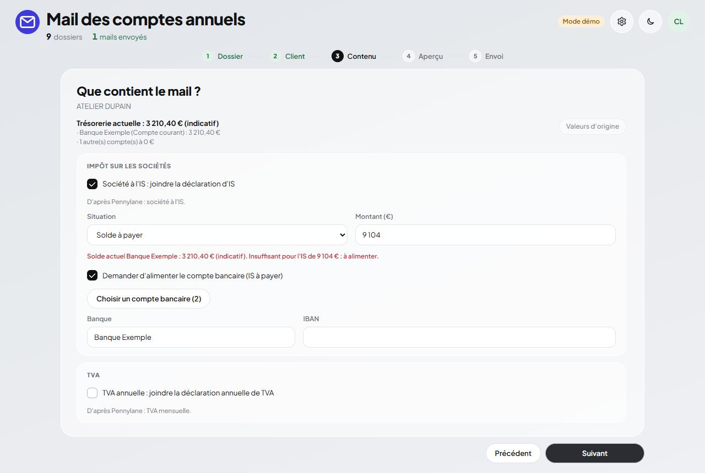
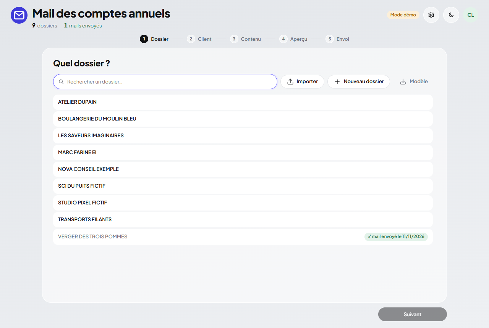
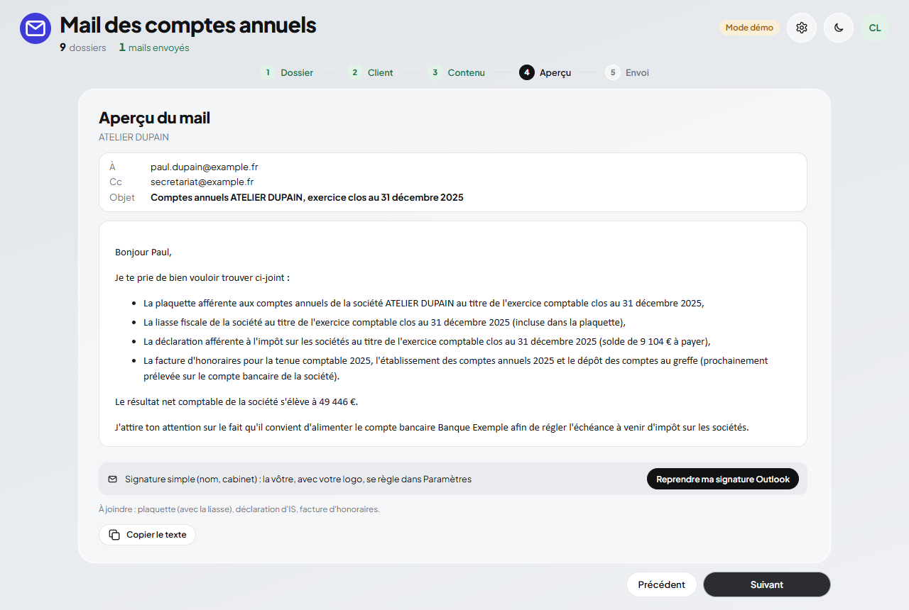

# Mail des comptes annuels

Every spring, a small accounting firm sends dozens of emails that all look alike: "here are your annual accounts, the tax return, the corporate tax statement, our invoice". Each one is written by hand from the trial balance, and each one is slightly different depending on the client.
That's where mistakes happen: a corporate tax amount copied wrong, a mention of the court registry for a company that doesn't file there, a client who has to top up their bank account and is never told.

I built this tool so the email writes itself from the client's figures, following the firm's rules, and refuses to go out while something is missing.

| Client list | Email preview |
|---|---|
|  |  |

## What it does

It reads the last closed financial year of a client and turns it into a ready-to-send email:

- **Net result and corporate tax** come from the trial balance (classes 6 and 7, account 695). Tax to pay, nil, or refundable changes the wording. A loss says "nothing to allocate".
- **Bank balance vs. tax due**: if the account can't cover the corporate tax, the email asks the client to top it up.
- **Tax regime and legal form** decide the attachments: corporate tax return only for companies under IS, annual VAT return only for yearly VAT filers, and no court registry filing for sole traders or property companies (SCI).
- **Occupancy allowance** paid to the manager is spotted in the 6132 accounts by its label, rounded to the euro and given with the exact box of the personal tax return (4BE).
- **Shifted financial years** (July to June) are handled: "exercice 2025-2026".
- **Tu or vous**, greeting, civility, CC: kept in each client's record and reused next year.
- Any manual change is saved per client, and a missing mandatory field blocks the email and says what to fill in.

It works with or without Pennylane and Outlook. With a Pennylane API token, clients and figures are read from Pennylane when you pick a client. Without it, you import a CSV or Excel file (see `exemples/dossiers.csv`) or create clients by hand. With Outlook connected, the email lands in your drafts with your signature. Without it, it opens in your mail app or downloads as an `.eml` file, and you tick "sent" yourself.

I wrote it in plain PHP 8 and JavaScript, without a framework, so it runs on basic shared hosting.

## Try it

You need PHP 8.2+ with the `dom`, `mbstring`, `openssl`, `simplexml` and `zip` extensions. No account, no internet.

- Windows: `demo.bat`
- macOS / Linux: `./demo.sh`

Then open http://127.0.0.1:8101 (login `demo` / `demo`, filled in for you). The demo has 9 made-up companies, each showing a different case. Pennylane is simulated with fake figures, and Microsoft is switched off.

## Use it for real

1. Copy `config.exemple.json` to `config.json` and set your firm name, email domain and user accounts.
2. Run `php outils/initialiser.php`: it creates the accounts and prints a temporary password for each (change it in Settings).
3. Point the web root to `public/` (or run `php -S 127.0.0.1:8080 -t public public/routeur.php` on one PC). `data/` must stay outside the web root.
4. In Settings, paste your Pennylane API token if you use Pennylane, and connect Outlook if you declared a Microsoft Entra app (`microsoft_client_id`). Both are optional.
5. Set your firm's rules (default invoice wording, payment terms, CC) under Settings › Mail des comptes.

## Tests

`pip install pytest requests cryptography` then `python -m pytest tests -q`.

They run the real PHP server against fake Microsoft and Pennylane servers, with and without each integration, and check the accounting rules one by one. One test starts the demo and makes sure nothing leaves the machine.

## Limits

- Data is stored in JSON files. Fine for a small team, but a bigger firm would need a real database.
- Microsoft and Pennylane are only tested against simulated servers in this repo.
- The attachments themselves (accounts, tax returns, invoice) are not generated: you add them in your mail app before sending.
- The email wording is French tax vocabulary, so it only makes sense for French companies.

The interface is in French, since it was made for a French firm.

MIT licence. Made by Mehdi Mobtahij.
